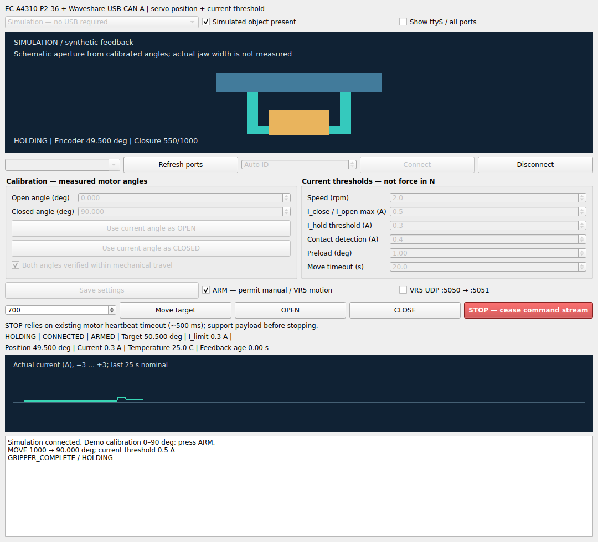

# EC Gripper Qt

Ứng dụng desktop Python + Qt/PySide6 điều khiển tay kẹp EC-A4310-P2-36 qua Waveshare USB-CAN-A, kèm mô phỏng và hình tay kẹp 2D ngay trên GUI.



## Tính năng

- Simulation: thử Open / Close / Move, vật cản giả lập, phát hiện tiếp xúc và giữ dòng; không cần USB.
- Real motor: driver EC-A4310 đã dùng trong project cũ, góc encoder thật điều khiển hình hiển thị.
- Chọn cổng kèm mô tả thiết bị; mặc định ẩn /dev/ttyS*, có tùy chọn hiện tất cả.
- Hiệu chuẩn hai đầu hành trình; vị trí yêu cầu 0–1000 được ánh xạ thành góc motor.
- Current threshold khi đóng/mở và giữ, tốc độ, preload, phản hồi nhiệt độ/dòng/vị trí.
- UDP tương thích VR5: cổng lệnh 5050, phản hồi hoàn thành 5051.
- Worker riêng cho CAN/UDP, GUI cập nhật khoảng 20 Hz.

## Phạm vi Simulink

Chưa có file .slx nguồn nên bản này chưa chuyển hoặc nhúng mô hình Simulink. Simulation hiện là mô hình Python đơn giản. MATLAB có thể gửi lệnh qua `matlab/gripper_command.m`; đây là UDP client chứ không phải Simulink model hoặc vòng điều khiển realtime. Muốn dùng đúng mô hình .slx, cần xác định đầu vào/ra, chu kỳ mẫu và toolbox của mô hình đó. Không cần MATLAB để chạy GUI này.

## Cài đặt

Yêu cầu Python 3.10 trở lên, Windows hoặc Ubuntu 22.04.

Ubuntu, mở terminal tại thư mục ec-gripper-qt:

```bash
python3 -m venv .venv
source .venv/bin/activate
python -m pip install -r requirements.txt
python main.py
```

Nếu chưa có venv: `sudo apt install python3-venv`. Nếu Qt thiếu xcb-cursor: `sudo apt install libxcb-cursor0`.

Requirements cố định `PySide6==6.8.3`. Đã tái hiện lỗi `Fatal Python error: none_dealloc: deallocating None` với Python 3.10 + PySide6 6.12.0 khi gọi Qt lặp lại; lỗi có thể xuất hiện trong `visual.py` hoặc hàm Qt khác. Nếu đã cài 6.12.0, đóng ứng dụng rồi dùng đúng Python chạy chương trình để cài lại:

```bash
python -m pip uninstall -y PySide6_Pdf PySide6_WebEngine
python -m pip install --upgrade --force-reinstall -r requirements.txt
python -m pip check
python main.py
```

Dùng `python3` thay `python` nếu đó là lệnh đang dùng để chạy ứng dụng. Không cần sửa `visual.py` hoặc thay đổi CAN/UDP cho lỗi thư viện này.

Windows, mở Command Prompt tại thư mục ec-gripper-qt:

```bat
py -m venv .venv
.venv\Scripts\activate.bat
python -m pip install -r requirements.txt
python main.py
```

## Chạy mô phỏng trước

1. Giữ chế độ **Simulation — no USB required**.
2. Nhấn **Connect**. Góc giả lập ban đầu 0°, demo calibration 0–90°.
3. Sau khi Connect thành công, điều khiển và UDP VR5 tự bật. Nhấn **CLOSE** để đóng tay kẹp.
4. Nhấn **OPEN**: hình tay kẹp mở theo phản hồi mô hình.
5. GUI không có vật giả lập; Close đi tới góc CLOSED đã cài.
6. Có thể nhập 700 và nhấn Move target; target=63° với demo 0–90°.

Hình 2D là sơ đồ tỷ lệ, không phải CAD hoặc phép đo khe mm. Mô hình synthetic dùng giới hạn tốc độ và vật cản, chưa mô phỏng điện/cơ đầy đủ và chưa dự đoán lực N. Dòng/nhiệt trong Simulation là giả lập. Trạng thái HOLDING chỉ xác nhận logic giữ, chưa có thuật toán xác nhận vật trượt/rơi.

## Điều khiển EC thật

1. Disconnect trước khi đổi mode. Chọn **Real EC-A4310 — USB-CAN**.
2. Chọn cổng có tên thiết bị Waveshare/USB Serial/CH340 tương ứng. Linux thường /dev/ttyUSB0; Windows COMx. Có thể nhập đường dẫn cổng trực tiếp. Danh sách liệt kê thiết bị hệ điều hành nhận được, không chứng minh cổng đang rảnh.
3. Connect chỉ cấu hình adapter, hỏi ID, đặt Q&A và đọc góc. Chờ 5.2 giây trước chuyển động.
4. Xác định **Open angle** và **Closed angle** trong hành trình cơ khí đã kiểm chứng. Có nút lấy góc hiện tại; không tự chạy tìm cữ. Không dùng góc demo 0/90 làm hiệu chuẩn robot thật.
5. Bấm **Save settings** để lưu góc OPEN/CLOSED và các thông số. Cấu hình thật nằm trong hardware_settings.json và không được đưa lên GitHub. Ứng dụng tự dùng cấu hình này ở lần kết nối sau; nếu gốc encoder thay đổi thì cập nhật góc đã cài.
6. Điều khiển tự bật sau khi kết nối nếu thông số hợp lệ. Thử thay đổi góc nhỏ bằng Move target trước khi chạy hết hành trình.
7. OPEN/CLOSE trên GUI gửi trực tiếp qua worker và CAN; không cần robot_main. Hình tay kẹp lấy góc encoder phản hồi, không chạy hoạt ảnh giả để thay thế feedback thật.

Driver gốc gửi servo-position 8 byte: position, speed, current threshold, ack=2. Dòng có độ phân giải 0.1 A theo driver cũ. Vòng servo nằm trong EC-A4310; Python không phát PWM/FOC.

Mặc định thử: tốc độ 2 rpm ở demo, I_close=0.5 A, I_hold=0.3 A, contact=0.4 A. Khi sang motor thật, kiểm tra/chỉnh lại theo cơ cấu. Giới hạn 3 A là cap của ứng dụng cũ, không đồng nghĩa dòng an toàn cho mọi tay kẹp. Không đổi dòng sang N khi chưa hiệu chuẩn cơ cấu/cảm biến.

**STOP** ngừng stream servo-position và dựa vào heartbeat motor khoảng 500 ms theo driver cũ. Đây không phải lệnh phanh/disable tức thì được xác minh; có thể làm mất lực giữ. Đỡ vật trước STOP/Disconnect/đóng cửa sổ. Chưa thử phần cứng EC thật trong môi trường tạo mã.

## UDP VR5 và MATLAB

**VR5 UDP tự bật sau khi Connect thành công**, không còn ô tích UDP hay ARM. Tắt simulator cũ để tránh tranh cổng 5050. Nếu cổng bận, nhật ký báo lỗi và điều khiển tại GUI vẫn dùng được; giải phóng cổng rồi Disconnect/Connect để thử lại.

| Nội dung | Chiều | Cổng |
|---|---|---:|
| `GRIPPER_OPEN` | robot_main/MATLAB → Qt | 5050 |
| `GRIPPER_CLOSE:700` | robot_main/MATLAB → Qt | 5050 |
| `GRIPPER_COMPLETE` | Qt → bên điều khiển | 5051 |
| `GRIPPER_ABORTED` | Qt → bên điều khiển | 5051 |

Dữ liệu ASCII, một lệnh/một datagram, không thêm ký tự xuống dòng. Chỉ một nguồn gửi lệnh tuần tự. Không chạy MATLAB client hoặc tools/send_udp.py cùng robot_main vì chúng cùng cần nghe 5051. Chỉ localhost (127.0.0.1) được cấu hình trong phiên bản này.

Lực/dòng/tốc độ chưa có trường UDP trong giao thức gốc: đặt trên GUI trước khi kết nối. COMPLETE phát khi tới target ổn định hoặc chạm vật và giữ ổn định; heartbeat CAN tiếp tục sau COMPLETE. ABORTED khi đang pending và bị STOP/lỗi/timeout. Sau COMPLETE nếu xuất hiện lỗi mới, GUI báo lỗi và dừng, nhưng giao thức VR5 chưa có thông báo lỗi bất đồng bộ được chuẩn hóa.

Thử bằng Python sau khi Qt kết nối Simulation thành công:

```bash
python tools/send_udp.py close --position 700
python tools/send_udp.py open
```

Thử bằng MATLAB có Instrument Control Toolbox và hàm udpport:

```matlab
addpath('matlab');
gripper_command('close',700)
gripper_command('open')
```

`matlab/gripper_command.m` đã viết theo API MathWorks, chưa chạy trong MATLAB tại đây. Cần file .slx của bạn để kết nối các block/signal cụ thể. Timeout client không đồng nghĩa motor đã dừng; kiểm tra Qt và STOP khi cần, không tự gửi lại lệnh.

## Lỗi cổng Ubuntu

Nếu dmesg báo ch341 attached ttyUSB0 rồi brltty ngắt cổng: khi không dùng thiết bị Braille, có thể gỡ `sudo apt remove brltty`, rút/cắm lại adapter, Refresh ports. Nếu báo Permission denied: `sudo usermod -aG dialout "$USER"`, đăng xuất/đăng nhập lại. Nếu không có USB trong danh sách, kiểm tra `lsusb` và log `sudo dmesg -w`. Cài lại Qt không giải quyết thiết bị USB bị ngắt ở tầng hệ điều hành.

## Cấu trúc mã

| File | Vai trò |
|---|---|
| main.py | Cửa sổ Qt, nút bấm, chọn cổng/mode, calibration |
| visual.py | Hình tay kẹp 2D theo góc phản hồi |
| backend.py | Worker CAN/UDP, kết nối, timeout, heartbeat |
| control.py | State machine, ánh xạ 0–1000, detection và hold |
| simulation.py | Motor giả lập để chạy không USB |
| ec_a4310_waveshare_test.py | Driver gốc từ project EC của bạn |
| matlab/gripper_command.m | Gửi lệnh UDP từ MATLAB |
| tools/send_udp.py | Client UDP Python để thử |
| GITHUB_VI.md | Tạo repository và push mã |

## Kiểm thử

```bash
python -m unittest discover -s tests -v
```

Đã qua 21 kiểm tra: parser, mapping hai chiều, contact/hold, fault/timeout, native CAN payload, UDP mock, giải phóng cổng UDP khi Disconnect, heartbeat/STOP, chu trình simulation close/hold/open, dò cổng USB và mô hình cơ khí. GUI đã được chạy offscreen với kết nối mô phỏng và hình tay kẹp, rồi đóng worker. Chưa chạy trên phần cứng EC thật; chưa kiểm thử MATLAB/Simulink.

GitHub Actions có sẵn tại `.github/workflows/tests.yml` để chạy bộ kiểm tra sau push.

## Nguồn

- Driver và nguyên lý contact/hold kế thừa ec_a4310_waveshare_test.py và ec_a4310_grip_hold_v3.py của project đã cung cấp.
- MATLAB UDP: https://www.mathworks.com/help/instrument/udpport.html
- GitHub import: https://docs.github.com/en/migrations/importing-source-code/using-the-command-line-to-import-source-code/adding-locally-hosted-code-to-github

Chưa đặt giấy phép phân phối vì quyền phân phối driver gốc cần do chủ repository xác định.
# ec-gripper-qt
# ec-gripper-qt


## USB port diagnostics update

- The port picker now stays accessible in Simulation. The mode banner and Connect simulation / Connect hardware labels identify which connection is used.
- Refresh scans pyserial and Linux ttyUSB/ttyACM nodes plus by-id/by-path aliases. CH340/CH341 VID:PID 1a86:7523 is highlighted as a candidate, not proof of Waveshare identity.
- Unfocused/disconnected lists refresh every two seconds. A typed path is preserved. Scanning never opens a serial port or sends commands.
- **Diagnose USB → Copy report** collects visible ports, permissions, USB inventory and relevant kernel messages. Restricted kernel logs are reported honestly; it never runs sudo or changes drivers.
- CLI alternative, inside the venv: `python tools/diagnose_ports.py`. Add `--port /dev/ttyUSB0` to check a selected device node.
- If Simulation was already connected, Disconnect before selecting Real EC-A4310. Missing ttyUSB nodes require resolving the Linux USB/driver conflict; a GUI change cannot recreate them.


## Giao diện hai tab

- **Điều khiển**: hình tay kẹp lớn, phản hồi động cơ, chọn vị trí và Open / Close / Stop.
- **Cài đặt**: chế độ mô phỏng/phần cứng, cổng USB, góc OPEN/CLOSED, dòng điện, tốc độ và cơ khí. Theo dõi/nhật ký mở ở cửa sổ riêng.
- Nút Stop ở góc trên luôn có thể truy cập từ cả hai tab.
- Hình tay kẹp là sơ đồ 2D, cập nhật theo góc phản hồi; không phải CAD 3D. Độ mở mm chỉ có sau khi cấu hình mô hình cơ khí (xem bên dưới). Phản hồi quá 0,5 giây được đánh dấu cũ.
- Chọn kết nối trong Cài đặt. Kết nối thành công tự bật điều khiển và UDP; không tự chạy động cơ.


## Cửa sổ theo dõi và độ mở cơ khí

Bấm **Theo dõi / Nhật ký ↗** ở tab Điều khiển (hoặc nút tương ứng trong Cài đặt) để mở cửa sổ riêng, không chặn cửa sổ chính. Có thể kéo sang màn hình thứ hai. Đóng cửa sổ theo dõi chỉ ẩn nó; dữ liệu vẫn cập nhật và nhật ký được giữ trong phiên (tối đa 600 dòng). Đóng ứng dụng chính sẽ đóng cửa sổ này. Nút STOP có ở cả hai cửa sổ.

Trong **Cài đặt → Cơ khí**, chỉ nhập **5 thông số chính** (mm): độ mở tối đa, tay quay `r`, thanh truyền `l`, lệch tâm `e`, và `Doffset`. Các ô không điều chỉnh hoặc khóa giá trị của nhau. Có thể lưu bản nháp dù chưa có nghiệm. Chương trình không tự thay đổi kích thước bạn nhập để ép một cơ cấu không khả thi thành hợp lệ.

```text
x(theta) = r*cos(theta) + sqrt(l² - (e-r*sin(theta))²)
D(theta) = Doffset + 2*x(theta)
```

`Doffset` là số bù có dấu của **toàn bộ độ mở hai ngón**, không phải độ lệch tâm `e`, có thể âm. Tại CLOSED = 0 mm, `Doffset = -2*x_closed`. Giữ quy ước nhánh căn dương của mô hình trước.

Khi đủ thông số hợp lệ, chương trình giải ngược để tự tính:

- Góc tay quay tại OPEN: `D = độ mở tối đa`.
- Góc tay quay tại CLOSED: `D = 0 mm`.
- Hành trình mỗi ngón: `độ mở tối đa / 2`.
- Độ mở trung gian và độ mở đích theo quan hệ phi tuyến.

Nếu có nhiều nhánh, hộp chọn nhánh chỉ xuất hiện khi cần; mặc định ưu tiên hành trình góc tăng. Cần chọn nhánh tương ứng với chiều lắp cơ khí thực. Các nhánh khác nhau có thể cho độ mở trung gian khác nhau khi `e != 0`. Không tự chọn nhánh theo dữ liệu encoder khi chưa biết quan hệ lắp cơ khí. Không có nghiệm hoặc miền căn không hợp lệ thì báo rõ và hiển thị `— mm`, nhưng vẫn cho sửa/lưu tất cả ô.

Ví dụ toán học để thử giao diện (không phải bộ tối ưu phần cứng): `Dmax=80`, `r=20`, `l=100`, `e=0`, `Doffset=-160` cho góc OPEN=0°, CLOSED=180° ở nhánh tăng; nửa hành trình góc cho khoảng 35,96 mm, không phải 40 mm.

Góc encoder OPEN/CLOSED vẫn được hiệu chuẩn riêng trong phần điều khiển động cơ. Phần hiển thị dùng `s=(encoder-encoder_open)/(encoder_closed-encoder_open)` và `theta=theta_open+s*(theta_closed-theta_open)`, giả thiết tỷ số truyền không đổi. Các góc tự tính **không** được ghi vào hiệu chuẩn phần cứng hay gửi xuống động cơ. Đây là độ mở theo mô hình, không phải cảm biến đo khoảng cách trực tiếp.

Bấm **Lưu thông số cơ khí** để lưu 5 giá trị và nhánh đã chọn vào `mechanical_settings.json`. Bộ số cũ có CLOSED=0 được chuyển thành Doffset khi đọc và giữ nhánh gần nhất; file chỉ được ghi lại khi bấm Lưu. Cấu hình cũ có CLOSED khác 0 cần chuyển đổi thủ công và được báo rõ, không tự ghi đè. Không còn ô xác nhận cơ khí hoặc xác nhận góc encoder; phần mềm kiểm tra tính hợp lệ của thông số trước khi cho phép chuyển động.


## Chọn vị trí ở tab Điều khiển

Kéo thanh trượt hoặc nhập **0–1000** (0 = mở, 1000 = đóng), rồi bấm **ĐẾN VỊ TRÍ**. Việc thay đổi giá trị chỉ chọn mục tiêu, không gửi lệnh chuyển động cho đến khi bấm nút. Cần kết nối thành công và có thông số góc hợp lệ như Open/Close. Độ mở đích theo mm được hiển thị ngay bên dưới nếu mô hình cơ khí hợp lệ; thang 0–1000 vẫn là hành trình góc, không phải mm.

Đã bỏ lựa chọn **Simulated object present** khỏi GUI. Khi kết nối mô phỏng, vật giả lập được tắt, hình không vẽ vật và tay kẹp có thể chạy hết hành trình hoặc tới vị trí trung gian. Khả năng kiểm thử tiếp xúc trong backend vẫn được giữ để kiểm thử tự động.


## Kết nối và điều khiển tự động

Đã bỏ ba ô tích **Both angles verified**, **ARM** và **VR5 UDP**. Sau khi kết nối motor thành công (đã nhận được góc phản hồi), GUI tự áp dụng thông số hiện tại, cho phép điều khiển nếu hợp lệ và mở UDP localhost 5050/5051. Chỉ kết nối không phát lệnh chuyển động. Chế độ Simulation cũng dùng cách này.

Nếu chưa cài góc hợp lệ (ví dụ OPEN và CLOSED đều bằng 0), vẫn cho kết nối để lấy góc hiện tại. Nhập/lấy góc OPEN/CLOSED rồi bấm **Save settings** để áp dụng và bật điều khiển. Không tự đo hay tự tìm cữ cơ khí. Kiểm tra giới hạn dòng, góc và thời gian chờ motor 5,2 giây vẫn được giữ.

**STOP** dừng và tắt quyền điều khiển; cập nhật giao diện định kỳ không tự bật lại. Muốn tiếp tục, Disconnect/Connect lại hoặc bấm Save settings khi đã dừng để áp dụng thông số và bật điều khiển. Sau STOP không tự phát lại lệnh cũ. Disconnect đóng cả USB-CAN và UDP.
